  

    

  

## Oie, sou a Nicole! 💜

Sou desenvolvedora de software, graduada em Análise e Desenvolvimento de Sistemas, e gosto de transformar problema de negócio em produto funcionando.

- 🏥 Trabalho no desenvolvimento de uma plataforma de gestão clínica, com foco em APIs e backend
- 💻 Fundei a **VN Softwares**, onde crio sites e melhoro a presença no Google de negócios locais
- ⚙️ Tenho experiência com filas e eventos, Docker e CI/CD
- 🌱 Sempre buscando evoluir e aprimorar minhas habilidades técnicas

## Tecnologias

  &nbsp;
  &nbsp;
  &nbsp;
  &nbsp;
  &nbsp;
  &nbsp;
  &nbsp;
  &nbsp;
  &nbsp;
  &nbsp;
  

## Vamos conversar?

  
  
  
  

